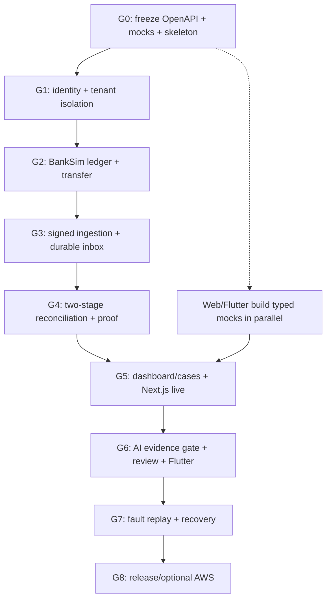

# SETTLEGRAPH AI — PROJECT MANAGER DELIVERY PLAYBOOK
## Delivery control document for a solo backend engineer + Next.js + Flutter team

**Version:** 2.1 | **Prepared:** 24 October 2026 | **Status:** Planned; no Go application has yet been implemented in this pack  
**Sources of truth:** `BACKEND_IMPLEMENTATION_BLUEPRINT.md` for behavior; `contracts/settlegraph-public.openapi.yaml` for public JSON/HTTP; `contracts/banksim-internal.openapi.yaml` for simulator APIs; the actual repository and passing tests for implementation status.

> **Project-manager's objective:** Deliver one complete, truthful customer journey—simulated bank payment → independent signed observation → deterministic payment/settlement reconciliation → explainable discrepancy → human review → recovered settlement—before increasing breadth. No one is rewarded for a long endpoint list that does not work.

---

## 1. Project charter and non-negotiable promise

**Working product:** SettleGraph AI is an evidence-backed payment monitoring and reconciliation application. It reads **simulated** financial-provider observations. BankSim is an independent testing system. SettleGraph does *not* move real funds, connect to real bank accounts, assert real-time bank balances, or declare funds stolen.

**Sponsor / decision owner:** Project lead (you). **Backend DRI:** Project lead until reassigned. **Web DRI:** Next.js developer. **Mobile DRI:** Flutter developer. **AI/cloud DRI:** Project lead. **Agent:** Executor; it does not own product decisions, modify scope silently, or mark tests passed without tool evidence. **DRI** means directly responsible individual.

**Target users in demo:** Merchant owner reviewing consolidated transaction status; finance reviewer investigating a missing settlement; hackathon judge controlling a deterministic fault scenario. All accounts and institutions are fictitious.

**Success conditions at final demo:**
1. Clean deployment/clone starts the API, worker and BankSim and both Postgres DBs from documented setup.
2. A merchant order and accepted payment from Bank A appear, with provider/source evidence and clear synthetic labels.
3. A controlled delayed settlement plus complete source watermark opens *one* case, not a fabricated payment loss claim.
4. Evidence-backed AI explanation (real Bedrock if accessible; explicitly labeled offline stub otherwise) links to real observation IDs; fabricated evidence is rejected by Go.
5. Releasing settlement creates a **new** reconciliation run, updates the case to `EVIDENCE_UPDATED`, preserves old run/audit history, and allows reviewer resolution via versioned decision.
6. Duplicate messages and out-of-order events do not double-count money; two tenant IDs cannot view each other's cases.
7. Web and Flutter read the same state through the frozen HTTP contract. Judges can watch an end-to-end path, not disconnected mock screens.

**Non-goals until the demo works:** Real banking APIs, real transfers, KYC/PCI, full fraud scoring, multi-currency, production push notifications, mobile money withdrawals, Kafka/Kubernetes, bank-grade settlement rails, batch CSV fallback, dozens of provider-specific adapters.

---

## 2. Project control: priorities, scheduling and capacity

### Priority bands

| Band | Meaning | Decision rule |
|---|---|---|
| **M0 — Demonstration spine** | Truly necessary to perform one reproducible payment-to-investigation-to-recovery demo | Do now; cannot be deferred |
| **M1 — Demo resilience** | Recovery, adversarial tests, dual-client integration, observability, real Bedrock where allowed | Do after M0 works |
| **M2 — Product breadth** | Rich charts, all optional list/details, CSV fallback, wallet C, polish | Cut if M0/M1 at risk |

The full contract already labels 24 public operations P0, 11 P1 and 4 P2. **That is a contract delivery target, not a 48-hour solo promise.** Keep those route names and DTOs frozen. For a short event, implement only the subset needed by a single complete scenario, then complete remaining P0 operations if time permits. Return documented `501 NOT_IMPLEMENTED` or omit undeployed routes in the running version; never return invented successful data as if implemented.

### Two scheduling envelopes

**Envelope A — 48-hour event, one backend engineer:** Aim for M0 vertical slice and a **local guaranteed fallback demo**. Target first end-to-end transaction by the first half of available engineering time; no production readiness claims. Defer optional analytics, CSV support, advanced AI and mobile write flows if ledger/reconciliation/integration is unstable.

**Envelope B — 8 to 12 focused engineering days, one backend engineer:** Cover all gates 0–8, 24 P0 operations, hardening and cloud smoke tests. These are planning assumptions, not elapsed-time estimates or promises. Re-plan against actual test progress and the event's real deadline.

**Protected time:** Reserve at least the final 15% of available work for integration stabilization, test replays and demo rehearsal. Declare feature freeze before that block. Do not start new features in the freeze window.

### Capacity reality

| Role | Focus | Can proceed before backend ready? | Deliverable required |
|---|---|---|---|
| Project lead / sole backend | Go modules, BankSim, DBs, reconciliation, APIs, worker, Bedrock, deploy | — | Runnable, tested services and deployment guide |
| Next.js engineer | Merchant dashboard, case list/detail, demo control room | **Yes**, using `fixtures/` and OpenAPI | Web app switched screen-by-screen from mock to live API |
| Flutter engineer | My-cases list, case details/evidence, reviewer decision | **Yes**, using fixtures | Mobile app reads same live case IDs/versions as web |
| Implementation agent | One backend ticket per execution loop; tests and evidence | Yes, under backend lead | Small commits + gate report, not generic summary |

**Rule:** Do not assign BankSim's private evaluator endpoints or true ledger database to frontend/mobile clients. Only the demo control room goes through SettleGraph's role-checked public `/v1/demo/*` routes.

---

## 3. Critical path and stop/go gates



| Gate | What the PM must be shown | Go/no-go policy |
|---|---|---|
| G0 | Clean clone/compose boot, `/health/live`, contract checker PASS, UI fixture handoff | **No-go** until contract names frozen and owners acknowledge |
| G1 | Auth 401/403/404 matrix, cross-tenant tests, request IDs and strict error shape | **No-go** if tenants can read each other's records |
| G2 | Balanced ledger, concurrency/no-overspend tests, scenario replay determinism | **No-go** if ledger can double-debit or imbalance |
| G3 | Valid/invalid HMAC, webhook replay 10x, outbox crash replay and cursor recovery | **No-go** if duplicate messages change money totals |
| G4 | Exactly two match stages, no amount-only matching, coverage/grace rules, versioned runs | **No-go** if AI or equal amounts can auto-confirm a match |
| G5 | Live web summary, transaction list, case detail and evidence; accurate freshness fields | **No-go** if mock data presented as live API |
| G6 | Fabricated evidence rejection; case version conflict 412; Flutter decision reflected on web | **No-go** if AI can alter financial evidence or bypass reviews |
| G7 | Normal/delayed/duplicate/outage replay tests with expected case histories | **No-go** if replay cannot reproduce final state |
| G8 | Exact startup/rollback/deploy steps, secrets outside repo, cloud budget alerts, smoke evidence | Release only the tested configuration; local demo remains available |

**No skipping gates.** A gate can be rescheduled or narrowed through a **documented scope change**, but its money and security invariants cannot be waived.

---

## 4. Executable project backlog — tickets, dependency and acceptance

IDs below are stable work-order identifiers for agent prompts. The detailed behavior is in the blueprint; the source contracts remain normative. An agent must not invent alternative routes or response fields.

### Sprint 0 — Contracts and runnable foundation

**SG-001 — Repository bootstrap** · Owner: Backend · Depends: none · M0
- Build Go module containing `cmd/api`, `cmd/worker`, `cmd/banksim`; modular packages and `Makefile` targets.
- Add two separate PostgreSQL services and deterministic env examples; omit all credentials from commits.
- **Accept:** Clean checkout builds three binaries, `go test ./...`, `go vet ./...`, `docker compose up` starts health.

**SG-002 — Freeze HTTP schemas and samples** · Owner: Backend + both client DRIs · Depends: SG-001 · M0
- Commit two OpenAPI YAMLs, JSON schemas, sample fixtures, API changelog.
- Give Next.js and Flutter developers the signed-off endpoint table, headers, roles, `Money` DTO and versioning rules.
- **Accept:** `python validation/validate_pack.py` passes; both clients render a fixture; written acknowledgment recorded.

**SG-003 — Data migrations and seed strategy** · Owner: Backend · Depends: SG-001 · M0
- Apply separate `db/001_settlegraph.sql` and `db/001_banksim.sql`; implement migrations-up command and deterministic scenario seed.
- **Accept:** Fresh empty databases migrate; rerunning migrations is safe; seed yields reproducible logical initial state.

### Sprint 1 — Identity and financial simulation

**SG-004 — API middleware, identity, tenancy** · Owner: Backend · Depends: SG-002, SG-003 · M0
- Implement demo JWT/access code, org memberships, role matrix, structured errors, request IDs, strict JSON, deadlines.
- **Accept:** 401 invalid token, 403 insufficient role, 404 foreign tenant resources, 400 malformed JSON; no leaked secrets.

**SG-005 — BankSim balanced journal and balances** · Owner: Backend · Depends: SG-003 · M0
- Implement accounts, opening equity, journals, postings, DB lock discipline; ETB as signed int64 minor units.
- **Accept:** Every journal sum=0; insufficient funds leave balances unchanged; 100 concurrent attempts cannot overspend.

**SG-006 — BankSim transfer/settlement lifecycle** · Owner: Backend · Depends: SG-005 · M0
- Implement `CREATED → ACCEPTED → SETTLEMENT_PENDING → SETTLED` and terminal `FAILED` with invalid-transition rejection.
- **Accept:** A synthetic 2,500 ETB payment and later settlement have correct postings; same idempotency key produces one financial effect.

**SG-007 — Scenario controller** · Owner: Backend · Depends: SG-006 · M0
- Implement deterministic seed/virtual clock; `normal_flow`, `delayed_settlement` first; other faults after vertical slice.
- **Accept:** Advance with stale `expected_step` is 412; scenario repeat yields same logical events independent of generated IDs.

### Sprint 2 — Independent observation and reconciliation

**SG-008 — Signed BankSim provider events** · Owner: Backend · Depends: SG-006 · M0
- BankSim outbox events with stable event ID, delivery-attempt metadata, per-provider HMAC, provider cursor API.
- **Accept:** Valid signature accepted; tampered/expired signature rejected; replay preserves stable event ID.

**SG-009 — SettleGraph durable inbox** · Owner: Backend · Depends: SG-004, SG-008 · M0
- Authenticate webhooks, persist deduplicated raw/normalized observations, enqueue via transactional outbox.
- **Accept:** 10 deliveries of identical event create exactly one logical observation; crash/restart safely replays.

**SG-010 — Worker, retries, source coverage** · Owner: Backend · Depends: SG-009 · M0
- Implement worker job leases, retries, DLQ/local equivalent, cursors and provider `complete_through` watermarks.
- **Accept:** Outage creates `INCOMPLETE_SOURCE`, not false missing funds; backfill restores coverage and no double-counting.

**SG-011 — Matching stage A (order → payment)** · Owner: Backend · Depends: SG-009 · M0
- Exact verified ref, amount and currency with uniqueness and deterministic snapshot.
- **Accept:** Missing/ambiguous ref creates no automatic match; same amount across unrelated orders never auto-matches.

**SG-012 — Matching stage B (payment → settlement)** · Owner: Backend · Depends: SG-010, SG-011 · M0
- Separate evidence proof edge, grace time and adequate source watermark before an unobserved-settlement case.
- **Accept:** Accepted is never rendered as settled; 1 minor-unit discrepancy is detected; settlement-first ordering converges.

**SG-013 — Immutable run persistence + proofs** · Owner: Backend · Depends: SG-011, SG-012 · M0
- Persist run snapshots, match witness/checks, evidence references, unresolved fingerprints and timeline events transactionally.
- **Accept:** Re-run doesn't rewrite history; run deduplication and unique allocations enforced under concurrency.

### Sprint 3 — Product APIs and AI

**SG-014 — Dashboard + transaction read APIs** · Owner: Backend · Depends: SG-004, SG-013 · M0
- Implement summary with `as_of`, source coverage, accepted vs settled distinction; list/get payments and settlements.
- **Accept:** JSON matches OpenAPI examples, pagination bound to tenant/filter, web shows real source freshness.

**SG-015 — Case APIs and timeline** · Owner: Backend · Depends: SG-013 · M0
- List/get cases, evidence and immutable case events; one stable case per recurring discrepancy fingerprint.
- **Accept:** Web and Flutter read same case; foreign tenant returns 404; late settlement becomes `EVIDENCE_UPDATED`.

**SG-016 — Human review / concurrency** · Owner: Backend + Flutter DRI · Depends: SG-015 · M0
- Versioned case decisions and `Idempotency-Key`; `If-Match` optimistic locking; immutable audit.
- **Accept:** Matching version resolves with reason, stale version 412, same retry creates one decision; Flutter/web agree.

**SG-017 — Bounded AI investigator** · Owner: Backend · Depends: SG-015 · M0
- Build compact evidence bundle from permitted case IDs; Bedrock adapter with deterministic labeled offline fallback; validate schema and identifiers.
- **Accept:** Fabricated evidence ID rejected; AI cannot set payment/settlement statuses, close case, or invoke transfer API.

**SG-018 — Demo orchestration APIs** · Owner: Backend + Web DRI · Depends: SG-007, SG-015 · M0
- Implement role-gated public `/v1/demo/*` delegation (no BankSim admin secret in browser).
- **Accept:** Authorized owner can create/advance scenarios; viewer cannot; request and response exactly match OpenAPI.

### Sprint 4 — Integration, hardening, release

**SG-019 — All four fault scenarios** · Owner: Backend · Depends: SG-010, SG-013, SG-018 · M1
- Duplicate notifications, reordered data, settlement delay, provider outage and recovery; restore deterministic test state.
- **Accept:** Four replay fixtures green, including old-run preservation and later settlement reconciliation.

**SG-020 — Cross-client smoke** · Owner: All active team members · Depends: SG-014, SG-015, SG-016, SG-018 · M0
- Web controls scenario; dashboard shows observed payment; Flutter sees same case and resolves it.
- **Accept:** One video/log trace with shared case ID, user ID, timestamps, response codes and no synthetic-vs-real ambiguity.

**SG-021 — AWS deploy and safety controls** · Owner: Project lead · Depends: SG-020 · M1
- Enable cloud integration only after local tests; configure runtime secrets, scoped IAM, TLS, budget alarm, queues if supported.
- **Accept:** Reproducible deployment, full smoke under cloud settings and tested local/offline fallback.

**SG-022 — Demo hardening / final acceptance** · Owner: Project lead · Depends: SG-019, SG-020 (SG-021 only if cloud required) · M0
- Freeze; clean scenario state; run all named tests; rehearse scripted demo; capture rollback/recovery commands.
- **Accept:** Two back-to-back fresh-seed demonstrations complete; known limitations written; build tagged; no unverified claims.

### Backlog discipline

- Do **one ticket** at a time with a branch named `feat/SG-###-short-name` or an isolated agent worktree.
- Agent must return: code diff, executed command, test output, endpoint changes, known failures and next dependency.
- Every ticket requires a reproducible test; a happy-path screenshot is not evidence of correctness.
- PR acceptance: backend DRI reviews financial effects; web/Flutter DRIs review contract changes; failing tests block merge.
- When a ticket is blocked, mark it `BLOCKED` and record an exact blocker; do not declare completion to keep the schedule attractive.

---

## 5. Week/day and 48-hour tactical schedule

### Recommended 10-day delivery view (if preparation time allows)

| Day | Core outcome | Integration commitment | Review gate |
|---|---|---|---|
| 1 | SG-001/002/003: boot, migrations and API freeze | Both clients render mocks | G0 |
| 2 | SG-004/005: auth, journal | Web can log in with demo JWT | G1 partial |
| 3 | SG-006/007: transfer, scenario clock | Web scenario control layout | G2 |
| 4 | SG-008/009: HMAC callback + inbox | Web reads provisional payment fixture | G3 partial |
| 5 | SG-010/011: worker/coverage + order match | Reconciliation response contracts validated | G3 |
| 6 | SG-012/013: settlement stage, cases, proofs | Web cases switch from mock to real | G4 |
| 7 | SG-014/015/018: dashboard, cases, demo APIs | Web live end-to-end path | G5 |
| 8 | SG-016/017: human decision, bounded AI | Flutter live review path | G6 |
| 9 | SG-019/020/021: replay, fault matrix, optional AWS | Combined demo rehearsal | G7 |
| 10 | SG-022: freeze, hardening, final smoke | Complete stakeholder acceptance | G8 or local equivalent |

The above is **an aggressive target**, not a guarantee. If effort exceeds capacity, extend the schedule or reduce scope before weakening correctness.

### 48-hour compression plan (only if that is the actual event window)

| Timebox | Must achieve | Features explicitly at risk |
|---|---|---|
| 0–6 hours | Boot, schema freeze, seeded demo auth and two DBs | Full Cognito auth, role administration |
| 6–16 hours | Minimal BankSim journal + one deterministic delayed settlement scenario | Third bank/wallet, broad bank APIs |
| 16–27 hours | Signed ingestion + simple durable job + exact two-stage matching | Full SQS cloud plumbing, fancy heuristics |
| 27–36 hours | Dashboard + case read, basic AI evidence summary, mock-ready Flutter | Deep analytics and all P1 operations |
| 36–42 hours | Late settlement recovery, duplicate replay and case audit | Fourth scenario if unstable |
| 42–48 hours | Freeze, tests, repeated demo and contingency | Any new feature |

**Escalation trigger:** If there is no real end-to-end BankSim → inbox → matching trace by **halfway through the available development time**, cut optional scopes and use deterministic local delivery instead of attempting cloud infrastructure first.

---

## 6. Contract management — frontend and mobile must not wait

### Public-client agreement

- Public source: `contracts/settlegraph-public.openapi.yaml` with **39 defined operations** (24 P0, 11 P1, 4 P2); BankSim internal contract has **10 operations**. A contract definition **does not mean** the endpoint is implemented.
- `GET /health/live` and `GET /health/ready` support deployment checks; `POST /v1/demo/sessions` is demo-only.
- All tenant calls require `Authorization: Bearer <jwt>` and `X-Organization-Id`; never trust organization role from a client-supplied body.
- Money JSON is `{ "minor_units": "250000", "currency": "ETB" }` for 2,500 ETB; avoid JS floating-point calculations.
- Async create typically returns `202`; clients poll resource GET; do not assume webhook/worker completion synchronously.
- Case mutation has `Idempotency-Key` and `If-Match: "<version>"`; 412 means refresh the case and re-evaluate.
- All “Bank A/Bank B” sources, source attestations and demo totals visibly say simulated; freshness watermarks must display clearly.

### Freeze-and-change rule

1. Write the proposed change to `docs/api-change-log.md`: operationId, old/new schema, compatibility, client impact and test fixture impact.
2. Update OpenAPI **first** and bump contract version (patch for compatible doc/optional addition; minor for additive endpoint; major for breaking changes).
3. Regenerate/validate DTO mocks and sample fixtures.
4. Notify both client developers in one brief handoff message including sample requests and the old/new field.
5. Obtain client acknowledgment **before** merging any breaking change. Prefer additive compatibility to breaking changes.

### Daily integration contract

| By checkpoint | Backend delivers | Web verifies | Flutter verifies |
|---|---|---|---|
| G0 | Frozen YAML, login/dashboard/case fixtures | Dashboard mocks deserialize | Case fixtures deserialize |
| G1 | Demo JWT and `/v1/me` | Login and org selector work | Token+org request headers work |
| G3 | Synthetic payment exposed through API | Payment list component parses | No blocking backend dependency |
| G5 | Summary/cases/evidence live | Scenario-to-case demo works | Case list/detail live |
| G6 | Case decision and investigation | Web sees updated version and audit | Submit decision, handle 412 |
| G7 | Recovery case transition | Show before/after cases | Show updated case after refresh |

**Frontend blocking SLA:** If a client is blocked on a contract shape, backend DRI must respond by pointing to the exact operationId and fixture—not with an undocumented ad hoc payload. Client developers must not directly query databases or BankSim admin APIs.

---

## 7. Data integrity and security quality plan

### Minimum testing pyramid

| Layer | Test type | Sample evidence |
|---|---|---|
| Unit | Money arithmetic, state transitions, exact reference matching, evidence ID checks | `go test ./internal/...` with deterministic fixtures |
| Property/fuzz | Balanced postings, no negative balances, monotonic versions, no duplicate allocations | Fuzz/property run with logged seed |
| Integration | PostgreSQL transaction rollback, unique indexes, ledger concurrency, inbox/outbox, HMAC | Separate DB test instances, no mock transaction commits |
| Contract | OpenAPI response and error envelopes, auth headers, enums, timestamps | Schema validation + runtime HTTP snapshots |
| E2E | Two-bank scenario and settlement recovery, four fault modes | Scenario log with source event IDs and case ID |
| Security | Cross-tenant unauthorized reads, role escalation, replay attacks, secrets in logs | Negative tests and secret scan |
| Demo smoke | Clean-start two consecutive runs, Flutter and web agree on case | Saved steps and actual outputs |

### Highest-risk defects to guard against

1. **False financial match:** exact amount/name is not sufficient; proof requires uniquely supporting references and tenant/snapshot-scoped evidence.
2. **Source outage mislabeled missing money:** require complete `complete_through` watermark and grace-period cutoff; otherwise show incomplete evidence.
3. **Double debit or duplicate settlement:** BankSim transactional ledger and idempotency enforced by the database, not only Go process memory.
4. **Duplicate webhook financial inflation:** unique provider event key, inbox/outbox, worker de-duplication; test crash after DB commit and after queue send.
5. **AI hallucinated evidence:** referential validation of all evidence IDs in case context, bounded JSON and role-limited actions.
6. **Cross-tenant leakage:** composite owner checks and object-level authorization for every list/detail/mutation (including cursor filters).
7. **Misleading money wording:** dashboard separates orders expected, payments accepted, settlements observed and provider freshness; no “live verified bank balance” claim.
8. **Timestamp and virtual-clock inconsistency:** scenario elapsed virtual time is separate from webhook-delivery freshness. Use real delivery clock for HMAC, virtual time for scenario grace/due logic.

### Non-negotiable proof targets

- 0 incorrect automatically confirmed matches in the seeded adversarial fixture set; no claim of global production accuracy.
- 100 same-idempotency-key transfer attempts yield 1 financial effect.
- Invalid HMAC rejects requests, without creating source observations.
- 10 identical webhook deliveries yield 1 normalized observation.
- A foreign tenant's existing resource ID yields 404 (no sensitive details).
- A stale review decision gets HTTP 412 and adds no audit decision.
- Fabricated evidence ID in an AI output is rejected and changes no payment/case state.
- Case history reflects both the earlier incomplete observation and the later settlement event.

---

## 8. Risk register, triggers and mitigations

| Risk ID | Probability / impact | Trigger | Preventive or contingency action | Owner |
|---|---|---|---|---|
| R-01 Scope overload with one backend engineer | High / Critical | No E2E trace at 50% of schedule | Freeze M2/M1; ship M0 spine; stop building provider breadth | Project lead |
| R-02 Bedrock model/region/account unavailable | Medium / High | Denied model invoke, quota exhausted | Offline investigator labeled `STUB`, preserve same JSON schema; retry cloud later | Backend |
| R-03 AWS billing surprise | Medium / Medium | Alarm or spend exceeds planned cap | AWS Budgets alarm, low traffic, short log retention, shutdown resources | Project lead |
| R-04 Ledger race / duplicate posting | Medium / Critical | Concurrency/property test fails | DB locks/constraints, fail gate G2, no public demo until fixed | Backend |
| R-05 Bank event signature or replay weakness | Medium / High | HMAC negative suite fails | Fail closed, replay window, per-provider secrets and stable event IDs | Backend |
| R-06 API drift breaks clients | High / High | Unannounced field/enum change | Freeze YAML; snapshots; changelog; two-client approval | Project lead |
| R-07 Partner developer unavailable | Medium / Medium | Web/mobile check-in missed | Keep core HTTP demo and a simple web status page; do not block finance engine | Project lead |
| R-08 Source coverage bug creates false loss | Medium / Critical | Case opens during provider outage | Require due+watermark; scenario test both states; fail G4 | Backend |
| R-09 Demo network fails | Medium / High | No AWS internet / connectivity | Fully local compose + deterministic stub and cached fixtures | Project lead |
| R-10 Unverified generated tests claim success | High / High | Agent reports PASS with no command output | Require test transcript, diff, commit SHA and precise skipped tests | Project lead |
| R-11 Exposed keys or test access code | Medium / Critical | Secret appears in client bundle/log/commit | Immediate rotate/revoke; secret scan; server-side demo config | Backend |
| R-12 Web/mobile inconsistent update order | Medium / Medium | UI shows stale case after settlement | Poll with version, case event timeline, invalidate caches on mutation | Client DRIs |

**Escalation:** Critical finance/security failures halt new features. Medium risks get mitigation within the next check-in. The PM owns the decision to shrink *scope*, not to weaken correctness.

---

## 9. Communication and project rituals

**Kickoff (20 minutes):** Confirm realistic event duration, deployment mode, roles, exact MVP path, frozen operationIds and fixture handoff. Record agreement in `docs/decisions/ADR-000.md`.

**Daily or every 4–6 hours during event (10 minutes):** Each contributor reports **Done / Evidence / Blocked / Next / Contract Impact**. Ask for running code and test output, not percentages.

**Backend handoff at each gate:** Publish `docs/implementation-progress.md` with latest commit, gate status, tests run, counts, uncovered cases, deployed URL or local command, sample request and response. Client engineers switch a screen to real API only after endpoint runtime contract test passes.

**Feature freeze meeting:** Lock branch, approve demo script, run all critical tests, announce any intentional stub/cut feature and environment URL. Only defects that block M0 may change after freeze.

**Status labels:** `NOT_STARTED`, `IN_PROGRESS`, `BLOCKED`, `CODED_NOT_TESTED`, `TESTED`, `ACCEPTED`, `DEFERRED`. **Never** use `DONE` solely because an AI agent wrote code.

### A concise progress report template

```text
Date/time (UTC):
Commit SHA / branch:
Ticket: SG-___  Status:
Gate: G___  Status: NOT_STARTED / PARTIAL / PASS / FAIL
Implemented paths/packages:
Tests executed (commands + PASS/FAIL counts):
Manual demo step verified (with request ID):
Contract diff: none / link
Known defects + severity:
Blocker / owner / next action:
Decision needed from PM:
```

### Scope-change decision record

```text
Change ID: CR-___
Reason and deadline consequence:
Original commitment:
Proposed replacement/defer:
Finance/security invariant affected? (must be NO)
OpenAPI/fixture/client impact:
PM approval + timestamp:
```

---

## 10. Demonstration plan: one auditable story in ~5 minutes

**Preflight:** Start services from clean state, verify both DBs and worker readiness, record a seed, reset scenario, ensure fake institutions labeled and AI mode shown (`BEDROCK` or `OFFLINE_STUB`).

| Time | Presenter does | System evidence shown |
|---|---|---|
| 0:00–0:35 | Explain merchant receives payments from two fictitious banks | BankSim/SettleGraph clear separation and dashboard freshness |
| 0:35–1:10 | Create delayed-settlement scenario for 2,500 ETB | BankSim transfer accepted; one source payment observed |
| 1:10–1:50 | Advance virtual time and source completeness | Reconciliation stage A matched; stage B unresolved; one case opens |
| 1:50–2:35 | Open case and trigger investigator | Linked real observation IDs; AI hypothesis, not false verification |
| 2:35–3:10 | Duplicate same webhook 10x | Still one payment/observation and unchanged money totals |
| 3:10–4:00 | Release settlement and reconcile again | New run, old proof retained, case timeline `EVIDENCE_UPDATED` |
| 4:00–4:35 | Flutter reviewer resolves case | Web shows version update/audit record; stale write fails 412 in test |
| 4:35–5:00 | Answer architecture question | Balanced ledger, separate DBs, HMAC, inbox/outbox, evidence gate |

**Backups:** If AWS Bedrock is unavailable, run the same evidence schema through the labeled local stub. If cloud networking fails, run compose locally. If Flutter is unavailable, show the HTTP review action in a documented API client—state honestly that the mobile client was not integrated.

**Demo outcome language:** “The simulator created synthetic funds and simulated bank records; SettleGraph matched those records under explicit rules.” Never say “we moved money between actual banks.”

---

## 11. Go / no-go release checklist

### Financial correctness
- [ ] BankSim journal is balanced on every posted transaction, including failure/retry conditions.
- [ ] Amount arithmetic never uses floating point for balances or matching.
- [ ] One customer transfer cannot be accepted twice via idempotent retry.
- [ ] Accepted ≠ settled; missing settlement requires due time and adequate source coverage.
- [ ] No AI suggested match can bypass deterministic verification.

### Security and isolation
- [ ] All org endpoints enforce membership and role checks.
- [ ] HMAC verification is constant-time, bounded by replay timestamp and payload size.
- [ ] Secrets are not in logs, fixtures, client apps or repository history.
- [ ] BankSim private evaluator truth API is not reachable by product credentials.
- [ ] CORS/transport/limits are configured for the demo origin and environment.

### Integration
- [ ] OpenAPI contract and mock fixtures validate; code responses align with schemas.
- [ ] Next.js demo uses real API for critical path and displays as-of/provider freshness.
- [ ] Flutter can load live case evidence and submit a versioned decision (unless declared cut).
- [ ] Two full end-to-end runs pass with fresh seeds and clear case timelines.

### Operating and presentation readiness
- [ ] All live cloud resources are within budget and shutdown instructions exist.
- [ ] Local offline fallback works without real-bank or AI credentials.
- [ ] One known-seed recovery demonstration is reproducible.
- [ ] Limitations and deferred endpoints are written; judges are never told stubs are real integrations.
- [ ] Final sign-off by project lead and both client DRIs.

---

## 12. What the coding agent receives at the start of every ticket

Use this message in addition to `AGENT_IMPLEMENTATION_INSTRUCTIONS.md`:

```text
You are implementing SettleGraph AI from a frozen specification.
Current ticket: SG-___, phase G___; implement ONLY the named ticket and direct prerequisites.
Treat BACKEND_IMPLEMENTATION_BLUEPRINT.md as behavioral source of truth.
Treat contracts/settlegraph-public.openapi.yaml and banksim-internal.openapi.yaml as normative HTTP contracts.
Treat PROJECT_MANAGER_DELIVERY_PLAYBOOK.md as delivery and acceptance control.
Do not invent production bank connectivity, mislabel simulator records as real, or silently change schemas.
Before coding: inspect repository, migrations, tests, current implementation-progress log and dependencies.
Implement in small commits. Every meaningful behavior needs failure-path tests.
Run static contract validation and the narrow tests; run full applicable Go/DB suite before declaring the ticket tested.
Provide a report with exact commands, observed output, changed files, API diffs, remaining failures and concrete next ticket.
If blocked: say BLOCKED with reason and suggested fallback. Never claim PASS without executing tests.
Never relax the ledger balance, idempotency, source coverage, tenant isolation or evidence-gate invariants to satisfy a superficial demo.
```

**Master PM acceptance rule:** The current milestone is complete only when the implementation is committed, the tests have actually run, the owning UI teammate has received the contract handoff, and the end-to-end observation agrees with the expected deterministic scenario.
