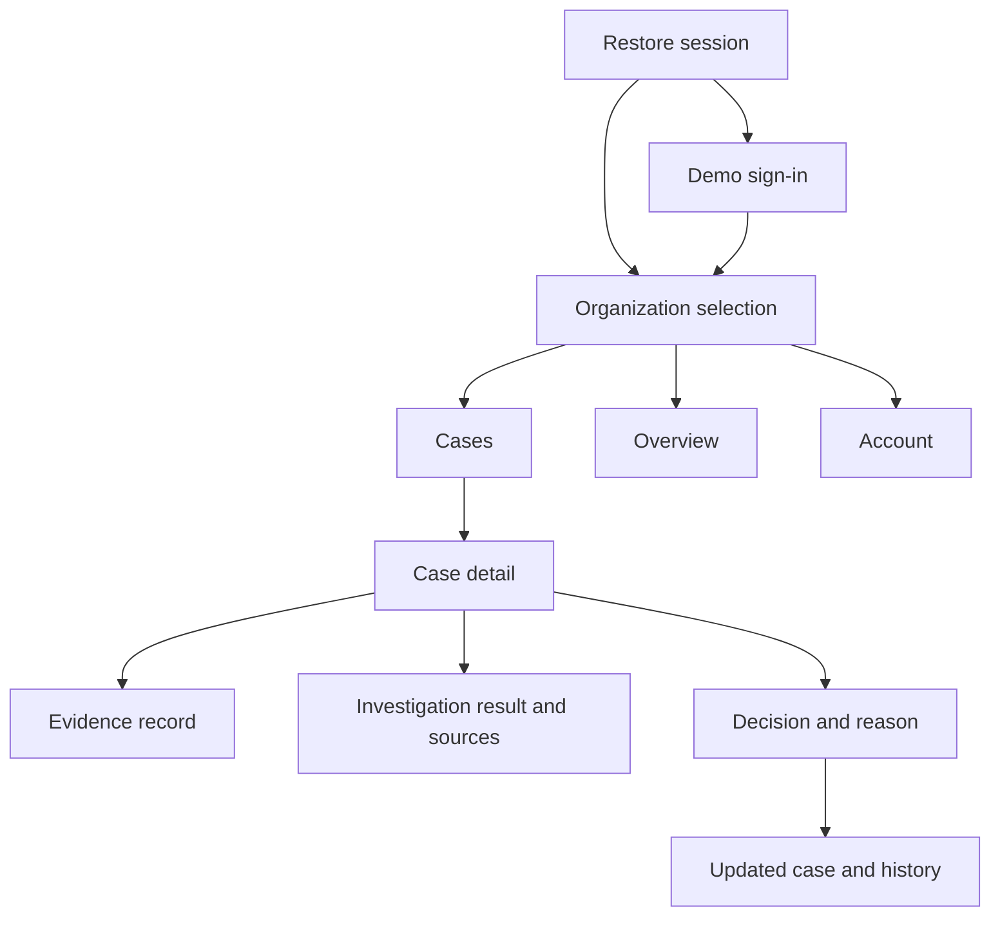

# SettleGraph mobile implementation and design plan

Prepared: 25 October 2026, Africa/Addis_Ababa. Branch: `feature/settlegraph-mobile`, created from `master`.

## 1. Outcome and scope

Build a polished Flutter reviewer app for Android and iOS. A reviewer should immediately understand what needs attention, inspect the supporting records, and record a decision confidently. Keep the interface quiet, consistent, and easy to operate with one hand.

The primary journey is **sign in → choose organization → open assigned case → inspect evidence and investigation → review updated settlement evidence → record a reasoned decision → see preserved history**.

This document is a plan, not an implementation-completion claim. The current request takes precedence over the older backend implementation prompt: this branch prepares the mobile work; it does not restart Go Gates 0–8 or change backend acceptance status. Existing financial behavior and public schemas remain unchanged.

MVP: demo sign-in, organization/session handling, cases, case evidence/history, existing investigation results, reviewer decisions, and a compact overview. Owner-only investigation creation/self-assignment may follow the read-and-review slice. Scenario orchestration stays in the web app or existing API demo script for the first cross-client demo.

Deferred: signup, password reset, Google login, email verification, real payments, push notifications, CSV imports, production identity, elaborate charts, app-store publication, and cloud actions.

## 2. Repository findings and prerequisites

Sources reviewed: `README.md`, `FRONTEND_MOBILE_HANDOFF.md`, `API_REFERENCE.md`, backend blueprint/playbook/backlog, public and BankSim contracts, JSON schemas, fixtures, implementation progress, and relevant Go handlers. The handoff/reference documents contain historical “not implemented” wording. The repository now contains mobile-related handlers, but handler presence and static schema validation do not establish runtime acceptance.

| Finding | Evidence | Consequence / planned action |
|---|---|---|
| Flutter 3.41.7 / Dart 3.11.5 installed | `flutter --version` | Use installed SDK initially; resolve compatible package versions and commit the lockfile. Do not blindly choose newest versions. |
| Xcode and CocoaPods detected | `flutter doctor -v` | iOS build tooling exists; app build still NOT_RUN. |
| Some Android SDK licenses unaccepted; no Android/iOS target currently connected | `flutter doctor -v` | Complete license review and start a simulator/emulator before native build/device acceptance. |
| Public case filters are ignored in current SQL | `internal/httpapi/reporting.go`, `cases()` | Blocking for trustworthy live “Assigned to me”, status filters, and scenario isolation in lists. Backend must apply `assigned_to`, `status`, `scenario_run_id` before pagination and test combinations. Do not filter only a fetched page and claim the queue is complete. |
| Demo login always mints `demo-owner` and updates that seeded user's display name | `internal/httpapi/httpapi.go`, `session()` | First live demo can use owner permissions. Independent REVIEWER/VIEWER sessions need a backend-owned test provisioning path. Never put signing secrets or arbitrary role selection in the app. Two owner sessions share an identity. |
| Four roles exist | Public `Role` schema and Go handlers | Preserve OWNER, ANALYST, REVIEWER, VIEWER; the abbreviated handoff omits ANALYST. |
| No refresh, registration, Google auth, password-reset or minimum-version endpoint | Public operation inventory | Reauthenticate on expiry/401. Defer unsupported auth screens and forced-update logic. |
| Case list has no money/provider fields or total count; no search/sort API | Public `Case` / `CasePage` | Show title, status, severity, assignment, evidence count, updated time. Do not invent amounts or aggregate counts on case rows, issue per-row evidence requests, or offer misleading global search/sort. |
| Investigation list currently ignores limit/cursor and returns ascending history | `internal/httpapi/investigation.go`, `listInvestigations()` | Test and fix pagination in backend before scaling history. Select latest by timestamp/id, not first element. Small demo history can still be displayed honestly. |
| AI integration is currently OFFLINE_STUB | Progress log and investigation handler | Render a clear source label. Bedrock is not a prerequisite for local mobile integration. |
| No organization-member directory endpoint | Public operations | Defer arbitrary teammate picker. Owner/analyst can self-assign using `/me.id` for the first demo if needed. |

Backend prerequisite fixes belong to SG-015/SG-017 and identity/test setup work around SG-004; mobile validation contributes evidence to SG-002, SG-016, and SG-020. Static review findings are not a substitute for a failing/passing runtime test.

## 3. One design reference and a distinct identity

**Primary reference: Mercury's mobile finance app.** Its official [mobile product walkthrough](https://mercury.com/blog/manage-finances-mobile-app) describes mobile review/approval and account switching. Use those focused workflows and its restrained financial-product direction as inspiration. Keep original SettleGraph branding, component implementation, and content. Reference screenshots were linked in the official article, but direct image retrieval returned 403 during this planning pass; visual comparison of those screenshots remains a first-design-step task.

Proposed direction: warm light surfaces, deep forest-green actions, precise typography, fine separators, and generous spacing. Financial evidence provides the visual interest. Show the app name as **SettleGraph** in navigation; retain the full project name in repository/backend documentation.

The signature component is an **evidence trail**: Order → Payment observed → Settlement observed. It gives the product its own recognizable visual language. On narrow screens or large text it becomes a vertical sequence. It must represent available evidence accurately: a settlement record alone is not proof of a deterministic match. A “Matched” label requires the public reconciliation proof; otherwise say “Observed” or “Not observed in available evidence”.

No chatbot home screen, sparkle icons, robot artwork, purple gradients, glowing cards, ornamental graph backgrounds, generic promotional copy, or decorative financial charts. Investigation pages use the familiar labels “Summary”, “Possible explanations”, “Sources”, and “Limitations”. Generated content remains labeled “Generated analysis” or “Demo analysis · offline”, rather than being disguised as a human finding.

### Proposed tokens

| Token | Value | Use |
|---|---|---|
| Background | `#F6F7F3` | Warm neutral canvas |
| Surface | `#FFFFFF` | Sheets and selected grouped surfaces |
| Primary / on primary | `#183F36` / `#FFFFFF` | Main action, selected navigation |
| Main text | `#1B2723` | Headings, readable body |
| Secondary text | `#626E68` | Metadata, helper copy |
| Divider | `#DDE3DD` | Decorative separators; not sole control boundary |
| Attention | `#936100` on `#FFF4DB` | Waiting, incomplete source |
| Error | `#B54736` on `#FFF0EB` | Failed action, validation |
| Positive | `#25604F` on `#E9F2EC` | Resolved case or observed result, with explicit label |

Computed text contrast: main/background 14.34:1; secondary/background 4.94:1; white/primary 11.65:1; attention pair 4.86:1; error pair 4.83:1; positive pair 6.41:1. These are proposed token checks, not finished screen accessibility results.

- Typography: proposed bundled Inter font with license, one family, regular/medium/semibold weights, tabular numerals for money. Titles 28–32, section titles 20, body 16, metadata 13–14 logical pixels. Respect text scaling.
- Spacing scale: 4, 8, 12, 16, 24, 32. Phone gutter 20–24. Buttons 52 high; all tap areas at least 48 × 48 logical pixels.
- Shape: modest 12–16 radius on controls and grouped surfaces. Prefer list rows and separators to wrapping every element in a card.
- Icons: one outlined family, proposed Lucide, consistent 20/24 sizing and stroke. Verify Flutter package compatibility before locking it. Selected state changes color/background; text labels stay visible.
- Motion: short pressed feedback around 100 ms, page/sheet transitions around 200–250 ms, reduced-motion alternatives. No animation that delays access to data.
- Light theme first; implement and independently test a dark token set in polish. Preserve platform back behavior, keyboard insets, safe areas, and focus order.

### Skills researched and applied

The curated skill catalog was checked. It offers Figma workflows but no dedicated Flutter design skill; there is no supplied Figma file to implement. Installed and read [UI/UX Pro Max](https://github.com/nextlevelbuilder/ui-ux-pro-max-skill) at commit `d14efff8ed1faa4187f004f79926f428c8074ec7` using the skill-installer helper. Installed path: `~/.codex/skills/ui-ux-pro-max/SKILL.md`; available for discovery on the next turn and read/applied explicitly in this planning turn.

Executed:

```bash
python3 ~/.codex/skills/ui-ux-pro-max/scripts/search.py 'financial operations mobile minimal' --design-system -p 'SettleGraph Mobile' -f markdown
python3 ~/.codex/skills/ui-ux-pro-max/scripts/search.py 'business finance dashboard' --design-system --stack flutter -p 'SettleGraph Mobile' -f markdown
python3 ~/.codex/skills/ui-ux-pro-max/scripts/search.py 'adaptive layout accessibility' --stack flutter
python3 ~/.codex/skills/ui-ux-pro-max/scripts/search.py 'error summary validation' --domain ux
```

The design generator returned marketing-page patterns, including after one narrower retry; `--stack` is ignored in its design-system mode. Those patterns were rejected and not persisted. The palette and screen composition above are project-specific design judgment. Applicable verified stack results were LayoutBuilder-based adaptation, Semantics, and screen-reader testing. Adopted the skill's native-app rules for consistent icons, semantic theme tokens, safe areas, touch feedback, 4/8 spacing, inline form errors, text scaling, and contrast. Translate web-oriented error guidance into Flutter semantics rather than importing HTML/ARIA implementation. The skill cites a newer Flutter line; verify APIs against the installed SDK.

## 4. Navigation and screens

Use three bottom destinations: **Cases · Overview · Account**. Open Cases by default for the review workflow. Each tab preserves scroll state. Case detail uses a full-screen route with a predictable back action; decision entry is a full-height sheet/page that remains usable with the keyboard and large text.



| Screen | Content and primary action | API |
|---|---|---|
| Sign-in | Small brand, display name, access code, “Continue”; persistent simulated-environment label; inline errors | `POST /v1/demo/sessions`, then `GET /v1/me` |
| Organization | Membership name and role; auto-select sole valid membership; switcher accessible later | `/v1/me` memberships |
| Cases | Assigned to me / All cases; Any / Open / Updated / Resolved status filter; concise rows and pagination | `GET /v1/cases` with documented filters, once backend prerequisite passes |
| Case detail | Title, status, severity, summary, evidence trail, evidence list, investigation preview, history; “Review case” for permitted roles | Case, `/evidence`, `/events`, `/investigations` |
| Evidence detail | Record type, reference, exact ETB amount if present, provider, timestamp; technical ID/hash in expandable details | Existing evidence response; load missing pages when following a citation |
| Investigation | Summary, hypotheses, individually tappable evidence citations, suggested actions as text, limitations, source mode, generated time | Investigation list/detail; creation for OWNER/ANALYST only |
| Decision | Resolve / Needs more evidence; Reopen for resolved cases; required reason; explicit submit and success feedback | `POST /v1/cases/{caseId}/decisions` |
| Overview | Separate order, accepted payment, observed settlement and unmatched amounts; open-case count; provider freshness | `GET /v1/dashboard/summary`; provider list if needed |
| Account | Name, organization, role, environment, appearance, app version, sign out | `/me`, local preferences |

Avoid a mandatory onboarding carousel. If introduction is needed, use one short dismissible explanation on first sign-in. No empty notification tab or nonfunctional search affordance.

Do not label a count from one page as the total “My cases” count. Keep the API's order until sorting is contracted. Translate enums only in presentation: `EVIDENCE_UPDATED` → “New evidence”; `SETTLEMENT_NOT_OBSERVED` → “Settlement not yet observed”; `INCOMPLETE_SOURCE` → “Source data incomplete”. Preserve wire values.

Every data screen needs initial loading, loaded, empty, refresh-in-progress, recoverable error, unavailable source, and expired-session states. An empty assigned queue should explain “No cases assigned to you” and offer All cases. A source outage must never become a “missing money” claim. Initial errors show Retry; failed refreshes can retain the prior in-memory snapshot with its timestamp and a stale banner.

## 5. Flutter architecture

Keep the requested `app/`, `core/`, and `features/` split, standalone JSON models, feature injection files, repository interfaces under `data/repositories/`, and BLoC/Cubit calling repositories directly. No additional domain/use-case layer.

```text
mobile_app/
  android/                         # generated in M01
  ios/                             # generated in M01
  assets/{images,icons,fonts}/
  lib/
    main.dart
    app/
      app.dart
      bootstrap.dart
      injection_container.dart
      router/{app_router,route_names,go_router_refresh_stream}.dart
      theme/{app_theme,app_colors,app_typography,app_spacing,app_motion}.dart
      widgets/{main_app_shell,update_required_gate}.dart
    core/
      config/app_config.dart
      error/{exceptions,failures}.dart
      network/{api_config,authenticated_http_client,network_info}.dart
      storage/{secure_storage,local_storage}.dart
      security/screen_shield_service.dart
      services/{app_version_service,session_manager}.dart
      models/{money,paginated_response,api_error}.dart
      utils/{validators,money_formatter,date_formatter}.dart
      widgets/{app_button,app_text_field,loading_view,empty_view,error_view}.dart
    features/
      auth/
      cases/
      investigations/
      overview/
      account/
  test/                            # mirrors lib/; helpers/mocks and fixtures
  integration_test/app_test.dart
  packages/                        # add only when there is reusable code
  pubspec.yaml
  pubspec.lock
  analysis_options.yaml
  README.md
.github/workflows/mobile_ci_validation.yml
.github/workflows/mobile_cd_google_play.yml  # deferred, manual release
```

For each feature:

```text
features/cases/
  cases_injection.dart
  data/
    datasources/cases_remote_datasource.dart
    models/{case_model,evidence_model,case_event_model,review_decision_model}.dart
    repositories/{cases_repository,cases_repository_impl}.dart
  presentation/
    bloc/cases/{cases_bloc,cases_event,cases_state}.dart
    bloc/case_detail/{case_detail_bloc,case_detail_event,case_detail_state}.dart
    bloc/decision/{decision_cubit,decision_state}.dart
    models/case_status_presentation.dart
    pages/{cases_page,case_detail_page,evidence_page,decision_page}.dart
    widgets/{case_row,evidence_trail,status_badge,case_timeline}.dart
```

Add local data sources only where needed: session persistence and preferences initially. Avoid empty services/models just to fill the tree. The user template's `token_refresh_manager.dart` becomes `session_manager.dart` until an actual refresh contract exists; signup/registration/email verification/Google files stay deferred. `update_required_gate` remains deferred rather than blocking the app on a fabricated version service. App-version display can be local. Screen shielding means a lifecycle privacy overlay; do not promise universal screenshot prevention on iOS.

GitHub Actions discovers workflows at repository-root `.github/workflows`, not `mobile_app/.github/workflows`. Use path filters for `mobile_app/**`, relevant contracts/fixtures, and the workflow itself; set `working-directory: mobile_app` for Flutter commands.

Proposed dependencies: `flutter_bloc`, `go_router`, `get_it`, `dio`, `flutter_secure_storage`, `shared_preferences` for non-sensitive preferences, `uuid`, `intl` for dates, one icon package, and `package_info_plus`. Tests use `flutter_test`, `integration_test`, `bloc_test`, and `mocktail`. Resolve SDK compatibility in M01 and commit `pubspec.lock`; do not pin speculative latest versions in this plan. Use immutable Dart models and sealed states; add code generation only when it reduces actual duplication.

The separation is consistent with [Flutter's architecture guidance](https://docs.flutter.dev/app-architecture/recommendations); [flutter_bloc](https://pub.dev/packages/flutter_bloc) supports both Bloc and Cubit, and [go_router](https://pub.dev/packages/go_router) supports redirect and shell navigation. The user's folder conventions remain the governing structure.

## 6. Session, requests, and data correctness

- Configure `APP_ENV` and `API_BASE_URL` with non-secret Dart defines. The app connects only to the product API. Keep demo access codes entered at runtime and never bundle signing keys, BankSim credentials, or database access.
- Keep bearer token/expiry in secure storage. Validate restored identity with `/me`; use its membership role, never a client-selected role. Organization changes clear prior data/cursors, cancel requests/pollers, and invalidate drafts. A response from the old session/org must not update the new screen.
- There is no refresh token. On expiry or 401, end the session once, clear sensitive cached state, and route to sign-in. Avoid concurrent redirect loops or retrying an unauthorized POST.
- Inject `Authorization` and `X-Organization-Id` in the authenticated client. Attach the access-code header only to demo login. Redact tokens, codes, and sensitive bodies from logs.
- Keep `minor_units` as a string at the boundary; format via `BigInt`, integer division, and exact fractional digits. Never route monetary arithmetic through `double`, including convenience number formatters.
- Decode required/null fields and UUIDs exactly. Unknown enums get an explicit unsupported state with mutations disabled; do not silently map them to resolved/success. Record contract drift without exposing secrets.
- Use opaque keyset cursors; reset on filter/org changes, deduplicate by ID, prevent overlapping page requests. Connectivity plugins are advisory; an active network interface does not prove API reachability.
- For decisions capture case version when review begins. Send quoted `If-Match: "3"` and one idempotency key per action. Network retries reuse the exact body, key, and version. A changed action/body gets a new key.
- On an uncertain POST timeout, show “Submission not confirmed” and allow retry with that same key. Do not optimistically resolve, queue offline writes, or silently submit on reconnect. Keep the retry envelope through in-session navigation; add secure short-lived persistence if app-termination recovery becomes required.
- On 412, keep the unsent reason, refresh case/evidence/history, show what changed, and require the reviewer to re-evaluate before another submit. Never auto-resubmit against the new version. Distinguish 409 transition/idempotency conflict from 412 stale version and 428 missing precondition.
- A successful decision updates from the server response, then refreshes list/history/overview. Closing a case does not change payment or settlement truth.
- Poll queued/running investigations at roughly 1–2 seconds while foregrounded, with bounded backoff and a visible long-running state. Stop on COMPLETED, FAILED, REJECTED, logout, organization change, disposal, or backgrounding. A 202 response may already contain a terminal result in the offline implementation.
- Refetch active case data on resume/pull-to-refresh. While a demo case is actively being watched, use a bounded foreground refresh loop; no permanent hidden polling or presumed push support.
- Citation links must resolve to evidence belonging to this case, including later evidence pages. Unavailable citations remain visibly unavailable; no invented records. Server validation remains authoritative. An investigation's snapshot hash is not a current-case version: after known evidence changes, mark the older result as historical until refreshed. The client cannot prove snapshot equivalence from timestamps alone.
- Keep fixtures and API repositories explicitly selected (`APP_ENV=fixture` versus `APP_ENV=demo`). Never silently replace API errors with fixture success. First MVP stores no persistent financial cache; stale reads are only the current session's retained in-memory data.

### Current handler capability matrix

| Capability | OWNER | ANALYST | REVIEWER | VIEWER |
|---|---|---|---|---|
| Read organization cases/evidence/results | Yes | Yes | Yes | Yes |
| Assign case | Yes | Yes | No | No |
| Create investigation | Yes | Yes | No | No |
| Record decision | Yes | Yes | Yes | No |
| Control demo scenario | Yes | No | No | No |

This matrix reflects inspected handlers. YAML does not encode a full decision-role policy; the blueprint's analyst policy is conditional. Before production identity, reconcile analyst decision policy explicitly with the backend owner. Mobile affordances do not replace server authorization; use a conservative owner/reviewer write UI if that policy remains unresolved.

## 7. Implementation milestones and gates

Mobile milestones are separate from the existing backend gate numbers. No milestone is TESTED until its commands execute and pass.

| Milestone | Files / deliverables | Acceptance gate |
|---|---|---|
| M00 — Plan and branch | This plan, mobile README, observed risk/progress notes | Branch created; static pack validation PASS; design and API constraints recorded |
| M01 — Runnable foundation | Native projects, `main.dart`, bootstrap/DI, core client/errors/storage, router/theme shell, models, fixture adapters, mirrored tests, root CI | Android/iOS scaffold; fixture JSON deserializes; organization isolation in client state; analyze and tests pass |
| M02 — Visual reference slice | Shared buttons/fields/status/list components; sign-in, case queue, case detail/evidence trail, decision screen with fixtures | Small/large phone layouts, large text, keyboard, empty/error/loading states; no dead actions; reference screenshots and golden baselines reviewed |
| M03 — Live session and reads | Auth/organization BLoC, cases/evidence/events repositories and BLoCs, summary/account | Live login and shared case ID; server filter prerequisite passes; 401/403/404, pagination, org-switch races covered |
| M04 — Investigation and decisions | Investigation history/result/citations, decision Cubit, conflict sheet, idempotency handling | Complete/failed/rejected analysis; citation navigation; same-key retry creates one decision; 412 forces fresh review; viewer cannot write |
| M05 — Cross-client recovery | `integration_test/app_test.dart`, scenario setup/trace, SG-020 evidence | Web/API starts delayed case; Flutter reads it; late settlement produces EVIDENCE_UPDATED; reviewer resolves; web/API sees identical version/history; all four scenarios checked |
| M06 — Polish and local release | Dark theme, semantic labels, final assets, documentation, build artifacts | Accessibility/device checks; profile-mode performance observations; Android debug APK and iOS simulator build pass; two repeatable local demo runs |

First implementation ticket: **M01**, followed immediately by the M02 case-detail reference screen. Prioritize one coherent review flow over parallel half-built features. A suitable first command after planning is:

```bash
flutter create --platforms=android,ios --project-name settlegraph_mobile mobile_app
```

Review generated files without overwriting this planning README. The final release application ID and signing identity remain release configuration decisions; local scaffolding does not require store publishing credentials.

### Validation commands to execute during implementation

From `mobile_app/` after scaffolding:

```bash
flutter pub get
dart format --output=none --set-exit-if-changed lib test integration_test
flutter analyze
flutter test --coverage
flutter test integration_test/app_test.dart -d <android-or-ios-device-id> --dart-define=APP_ENV=demo --dart-define=API_BASE_URL=<reachable-product-api>
flutter build apk --debug
flutter build ios --simulator --no-codesign
```

Root contract/runtime checks (activate the ignored virtual environment first so existing Make targets can find `python`):

```bash
source .venv/bin/activate
python validation/validate_pack.py
make up
make migrate
make seed
make smoke
make test-contract-runtime
make test-e2e
```

If backend prerequisites are modified, also run `go test ./...`, `go vet ./...`, and database-backed integration tests for the changed handlers. Use isolated test databases and scenario-specific runs; preserve existing evidence/history. These commands are future gates, not commands reported as executed in this planning turn.

### Tests that matter

- Model/contract tests: canonical fixtures, nullable evidence amounts/providers, unknown enums, exact ETB values including large and negative amounts, UTC conversion, and page cursors.
- Repository/BLoC tests: session restoration/expiry, cancelled old-org requests, stale refresh errors, pagination/filter reset, HTTP envelope mapping, polling disposal/terminal states.
- Decision tests: double tap, uncertain timeout and same-key replay, changed body/new key, 412 conflict with retained reason, 403 viewer, 404 inaccessible case, state update only after server success.
- Widget tests: long case titles, no-money case list rows, evidence citation loading/unavailable state, incomplete-source language, keyboard-visible submit, large text, TalkBack/VoiceOver semantics, meaningful contrast and tap targets.
- Goldens: fixed fonts/time/device sizes; review changes rather than blindly updating baselines. Cover sign-in, queue, case detail, conflict, and both themes when implemented.
- Integration: normal, delayed, duplicate event, and provider outage/recovery; old history remains; no fabricated settled state. Owner-only demo acceptance must be labeled separately from real multi-role acceptance.

## 8. Device and demo setup

Android emulator typically reaches the host through `http://10.0.2.2:8080`; iOS simulator uses `http://127.0.0.1:8080`. Verify each target. A physical device cannot reach a host service bound only to 127.0.0.1: use an explicit developer-controlled tunnel/port forwarding or a scoped development bind after reviewing connectivity. Do not widen the backend bind as an incidental mobile change.

Permit development HTTP only in debug configuration as required by platform networking rules; release builds require the eventual HTTPS product endpoint. Never use BankSim port 8082 as the client base URL. Local Compose plus OFFLINE_STUB has no model/cloud requirement; a fixture-only preview has no backend requirement and remains labeled as sample data.

Android license review is a developer setup step (`flutter doctor --android-licenses`); it was not accepted automatically during planning. Start an emulator or iOS simulator for integration tests. A working Xcode installation alone does not count as a successful app build.

## 9. Actual verification in this planning pass

| Check | Result |
|---|---|
| Initial `git status --short` | Clean working tree on master |
| `git switch -c feature/settlegraph-mobile` | PASS — branch created |
| `flutter --version` | PASS — Flutter 3.41.7, Dart 3.11.5 |
| `flutter doctor -v` | Completed with Android license warning; Xcode/CocoaPods detected; no Android/iOS device attached |
| `python validation/validate_pack.py` | NOT_RUN initially: `python` executable absent |
| `python3 validation/validate_pack.py` | FAIL initially: missing PyYAML |
| `.venv/bin/python -m pip install -r validation/requirements.txt` | PASS after creating ignored local venv |
| `.venv/bin/python validation/validate_pack.py` | PASS — 39 public operations/55 schemas, 10 internal operations/16 schemas, JSON schemas, 22-ticket graph, fixtures and negative AI evidence fixture |
| UI/UX Pro Max installation and search commands | PASS; unsuitable design-generator layout recommendations explicitly rejected |
| Proposed color contrast calculation | PASS for six proposed text/background pairs; actual screens not yet tested |
| Flutter app tests/builds; Go tests/vet; DB migrations; live cross-client demo | NOT_RUN — no application/backend implementation performed in this planning task |

Next gate: M01 scaffold/model tests, then the M02 case-detail visual reference. Live assigned-case acceptance is blocked on the observed backend filtering defect; fixture implementation can proceed immediately.
